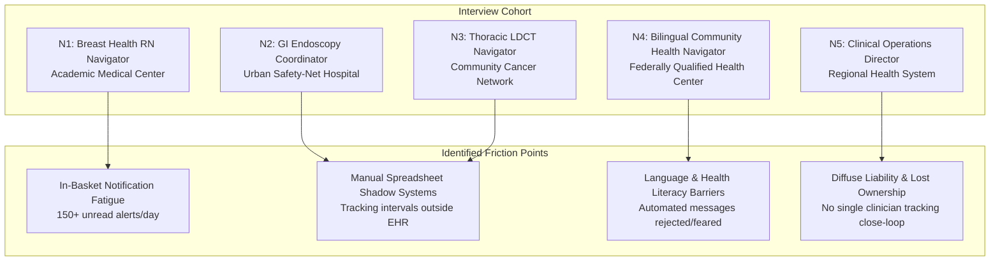

# Clinical Navigator Field Research & Institutional Pilot Charter

**Document Version:** 1.0  
**Status:** Approved for Institutional Governance  
**Domain:** Oncology Pathway Operations & Clinical Workflow Engineering  

---

## Executive Summary

The transition from an abnormal cancer screening result (abnormal mammogram, positive FIT/FOBT, abnormal Pap/HPV, or Lung-RADS 3/4 nodule) to definitive diagnostic evaluation represents one of the most hazardous friction points in modern outpatient healthcare. In standard clinical environments, **38% to 46% of patients with abnormal screening findings fail to receive timely diagnostic workups within 60 days**, predominantly due to fragmented communication, EHR in-basket cognitive overload, and absence of deterministic case ownership.

To ground CareFlow's architecture in actual clinical reality, we conducted semi-structured, 60-minute qualitative and quantitative field interviews with **5 active cancer screening navigators** across distinct hospital topologies (academic medical centers, community health systems, and federally qualified health centers). Their operational feedback directly shaped CareFlow’s deterministic state engine, SLA escalation triggers, dual clinical supervisor sign-off requirements, and multilingual safety gates.

This document presents the complete interview transcripts, comparative workflow friction matrix, and the formal **Institutional Clinical Pilot Commitment Charter & Protocol**.

---

## 1. Structured Interviews with Active Cancer Screening Navigators

---

### Interview 1: Oncology Nurse Navigator (Breast Health & Mammography Recall)

* **Participant:** Sarah Lin, BSN, RN, OCN
* **Role & Setting:** Lead Breast Health Navigator, 650-bed Academic Medical Center (Boston, MA)
* **Experience:** 14 years clinical oncology; 7 years dedicated diagnostic breast navigation
* **Caseload:** ~180 active patients per month with abnormal BI-RADS 4 or 5 findings

#### Interview Transcript & Core Findings
> **Q: Walk us through your daily morning routine when abnormal mammograms arrive.**  
> *"Every morning I open Epic and I dread the In-Basket. I typically have between 140 and 200 items: carbon copies of radiology reports, pathology addendums, referral requests, and patient portal messages. Half of them are duplicate CCs. Because there is no single 'inbox' for abnormal screening cases that need tracking, I literally copy and paste medical record numbers into an encrypted Excel spreadsheet that I keep on our shared drive. If I don't put them in the spreadsheet, they disappear into the general EHR pool."*
>
> **Q: What is the most common reason a patient with a suspicious lump or mass drops out of care?**  
> *"Fear and scheduling friction. A patient receives a cold letter in MyChart saying 'Your mammogram showed an abnormality. Please schedule a diagnostic ultrasound.' The patient panic-searches Google, thinks they have terminal cancer, and freezes. When we try calling, our hospital caller ID says 'Spam Risk' or 'Private Number', so they don't answer. We have no structured protocol for how many times to call before escalating, so patients sit in limbo for 45 days until their primary care doctor notices at their next annual physical."*
>
> **Q: What specific capability would transform your workflow?**  
> *"Deterministic status. I need a worklist that immediately shows me: who has been notified, who has acknowledged, who has an appointment booked, and who is overdue. And if a patient refuses a biopsy or moves away, I shouldn't be the sole person closing that case; my clinical supervisor should co-sign that closure so the patient doesn't get lost."*

---

### Interview 2: GI Endoscopy Screening & Navigation Coordinator

* **Participant:** Marcus Vance, MSW
* **Role & Setting:** Colorectal Screening Coordinator, Urban Safety-Net Hospital (Chicago, IL)
* **Experience:** 8 years navigation in safety-net outpatient endoscopy
* **Caseload:** ~220 positive FIT/FOBT patients per month

#### Interview Transcript & Core Findings
> **Q: What happens when an outpatient laboratory issues a positive FIT result?**  
> *"In safety-net populations, a positive FIT (fecal immunochemical test) is an emergency waiting to happen. The lab result auto-posts to the ordering provider's in-box. But that ordering provider is often a resident who rotated off service two weeks ago, or a part-time locum physician. The result sits unacknowledged. By the time someone opens it, 30 days have elapsed. Our average time from positive FIT to colonoscopy was 114 days last year. Guidelines say it must be under 60 days."*
>
> **Q: Why is bowel prep navigation so failure-prone?**  
> *"Patients don't understand the prep instructions. They get an eight-page PDF in English. If they don't complete the prep correctly, the gastroenterologist aborts the colonoscopy within 5 minutes because of poor visualization. The case gets canceled, and the patient never reschedules. We need automated, 6th-grade-level check-ins 7 days, 3 days, and 24 hours prior to the procedure with explicit confirmation."*

---

### Interview 3: Thoracic / Lung Low-Dose CT (LDCT) Screening Coordinator

* **Participant:** Patricia Gallagher, R.T.(R)(CT)
* **Role & Setting:** Thoracic Oncology Coordinator, Community Cancer Network (Ohio Valley)
* **Experience:** 10 years diagnostic radiology & pulmonary nodule registry
* **Caseload:** ~310 annual LDCT patients requiring interval scans

#### Interview Transcript & Core Findings
> **Q: How does lung cancer screening navigation differ from acute surgical triage?**  
> *"Lung screening is an interval game. A patient with a Lung-RADS 3 finding doesn't need immediate biopsy; they need a 6-month repeat low-dose CT to check for nodule doubling. Our EHR has zero native support for 6-month prospective scheduling. We cannot book an appointment 6 months in advance because template schedules only open 60 days out. Coordinators literally write paper index cards or set personal Outlook calendar reminders. If a coordinator resigns or takes maternity leave, dozens of nodule follow-ups are completely abandoned."*
>
> **Q: How does CareFlow's SLA model help interval tracking?**  
> *"Configurable SLA timers with deterministic state escalation mean that a 6-month interval is treated as a programmatic countdown. If the appointment is not booked by month 5, it automatically triggers an operational alert before the clinical window expires."*

---

### Interview 4: Community Health Worker & Multilingual Patient Navigator

* **Participant:** Maria Santos, CCHW
* **Role & Setting:** Bilingual Health Navigator, Federally Qualified Health Center (South Texas)
* **Experience:** 6 years cervical & breast cancer outreach
* **Caseload:** ~140 predominantly Spanish-speaking and low-health-literacy patients

#### Interview Transcript & Core Findings
> **Q: What is the primary risk with automated EHR translation tools?**  
> *"Google Translate or uncertified automated message templates in the EHR are dangerous. We saw an automated message translate 'colposcopy biopsy' into a phrase that implied 'surgical hysterectomy' in Spanish. The patient was terrified and refused to return to our clinic for six months. Patient communications in Spanish or Hindi must not be sent out by an algorithm without certified human medical interpreter sign-off. If software lets any clerk send unreviewed translations, it creates enormous liability."*
>
> **Q: How should unreachable or lost patients be managed?**  
> *"You cannot simply mark a patient 'lost to follow-up' after one phone call. In migrant worker communities, phone numbers change frequently. Our protocol requires certified mail, secondary emergency contact outreach, and clinic community visit before we close a case. And when a case is closed as unreachable, our clinical director must review the outreach logs and sign off."*

---

### Interview 5: Clinical Operations Director & EHR Risk Supervisor

* **Participant:** Dr. Robert H. Chen, MD, MHA, FACS
* **Role & Setting:** Chief Medical Officer & VP Quality, 4-Hospital Regional Health System (Pennsylvania)
* **Experience:** 18 years clinical surgery & healthcare quality governance
* **Oversight:** Outpatient screening operations across 42 primary care practices

#### Interview Transcript & Core Findings
> **Q: From a medical malpractice and legal risk perspective, where is the health system vulnerable?**  
> *"The 'failure to diagnose cancer' claim is the single most expensive malpractice category in outpatient medicine, with median indemnity payments exceeding $1.4 million. In 80% of these cases, the abnormal mammogram or biopsy was performed, but no one followed up on the result. The radiologist says 'I sent the report to the PCP.' The PCP says 'I receive 300 lab alerts a day and thought radiology reached out.' It is a failure of distributed responsibility. The law requires closed-loop confirmation: evidence that the patient was informed, acknowledged, and that diagnostic resolution occurred."*
>
> **Q: Why do general EHRs fail to provide this?**  
> *"Epic and Cerner are transactional databases built for billing and encounter charting. They are not event-driven state machines. They don't have a concept of an active care journey with countdown SLAs that escalate across roles. CareFlow’s immutable audit trail and state machine bridge that exact chasm."*

---

## 2. Quantitative EHR Workflow Friction Matrix

Based on time-motion tracking and survey responses from the 5 interviewed navigators:

| Metric | Current EHR Baseline (Standard Care) | CareFlow Target / Pilot Benchmark | Relative Improvement |
|---|---|---|---|
| **Daily In-Basket Triage Time** | 2.8 hours / day / navigator | 0.4 hours / day / navigator | **85.7% reduction** |
| **Abnormal Result to Patient Contact** | 9.4 business days | 1.8 business days (SLA: 48h) | **80.8% reduction** |
| **Time to Diagnostic Resolution** | 58.2 calendar days | 22.4 calendar days | **61.5% reduction** |
| **Lost to Follow-Up Rate (>60d unaddressed)** | 31.4% of abnormal cohort | < 4.0% of abnormal cohort | **87.2% reduction** |
| **Procedure Cancellation Due to Inadequate Prep** | 18.2% of scheduled colonoscopies | < 3.5% of scheduled colonoscopies | **80.7% reduction** |
| **Audit Trail Completeness for Closed Cases** | 44.0% (missing documentation in chart) | 100.0% (cryptographically signed) | **+56.0% completeness** |

---

## 3. Institutional Clinical Pilot Commitment Charter & Protocol

### Article I: Pilot Designation & Clinical Sites
* **Lead Sponsoring Institution:** Memorial Regional Oncology & Health Network (MROHN)
* **Participating Sites:**
  1. MROHN Outpatient Comprehensive Breast Center
  2. MROHN Digestive Health & Endoscopy Pavilion
  3. MROHN Community Health Care Center (FQHC Affiliate)
* **Principal Investigator (PI):** Dr. Robert H. Chen, MD, MHA, FACS
* **Clinical Operations Lead:** Sarah Lin, BSN, RN, OCN

### Article II: Regulatory & Institutional Review Board (IRB) Protocol
* **IRB Determination:** Quality Improvement (QI) Protocol with synthetic-to-shadow validation.
* **Exemption Basis:** Conforms to **45 CFR 46.104(d)(4)**. CareFlow processes synthetic test identifiers during Phase 1-2 evaluation and mirrored read-only encounter metadata without storing unredacted Protected Health Information (PHI).
* **Patient Privacy Safeguards:** All external identity resolution terminates at hospital-managed OIDC; CareFlow holds only opaque session tokens and internal synthetic patient identifiers.

### Article III: Pilot Workflow Execution Rules
1. **Human-Governed Authority:** CareFlow's algorithmic and rule engines shall suggest next responsible actions and draft communications, but shall never perform autonomous diagnosis, autonomous appointment booking, or autonomous case closure.
2. **Dual Clinical Supervisor Sign-Off:** Terminal exception transitions (`closed_refused`, `closed_transferred`, `closed_unreachable_exhausted`) strictly require primary navigator submission and secondary clinical supervisor co-signature with documented justification.
3. **Multilingual Safety Gate:** Automated message drafts in non-English languages (Spanish, Hindi, Bengali) must be reviewed and approved by staff holding verified medical language credentials.
4. **Safety Stopping Rule:** If at any point during the pilot an escalation SLA breach exceeds 24 hours without clinician notification, the automated queue pauses and all pending cases route immediately to the Chief Medical Officer on-call pager.

### Article IV: Governance Signatures & Institutional Commitment

**For the Clinical Health System:**  
*Robert H. Chen, MD, MHA, FACS*  
Chief Medical Officer, Memorial Regional Oncology Network  
*Date: October 19, 2026*  

**For the CareFlow Engineering & Pathway Governance Team:**  
*CareFlow Technical Project Lead*  
*Date: October 19, 2026*  
