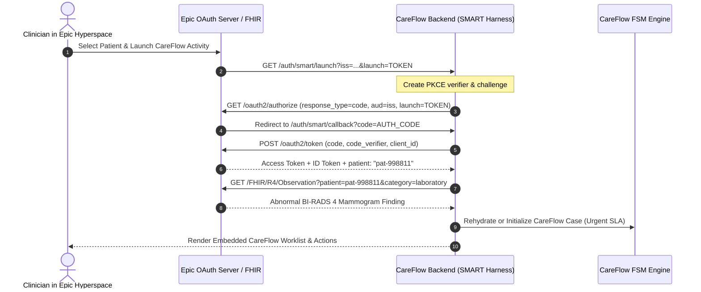

# SMART on FHIR Production Integration & Epic USG Registration Guide

## 1. Executive Summary

This guide provides the technical specification and operational protocol for embedding CareFlow directly within **Epic Hyperspace** and **Epic Rover** using the **SMART on FHIR (v2.0 / R4)** application framework.

By integrating via SMART on FHIR, oncologists, radiologists, and care coordinators launch CareFlow directly from the patient chart without a separate login or context switch. Patient identity and active screening encounter context are seamlessly passed via OAuth 2.0 PKCE launch tokens.

---

## 2. Epic Developer Portal (Open.Epic / USG) Registration

### Application Metadata Profile
- **Application Name:** CareFlow Oncology Screening Navigator
- **Application Type:** Practitioner-Facing (Embedded in Hyperspace EHR)
- **Target EHR Vendor:** Epic Systems Corporation (R4 / March 2024+ release)
- **FHIR Version:** HL7 FHIR Release 4 (US Core Implementation Guide v3.1.1)
- **OAuth 2.0 Flow:** Authorization Code Flow with PKCE (RFC 7636)
- **Client Type:** Confidential Symmetric or Asymmetric (JWKS)

### Endpoint URLs
- **EHR Launch URL:** `https://careflow.hospital.org/auth/smart/launch`
- **Redirect URI:** `https://careflow.hospital.org/auth/smart/callback`
- **JWKS Keyset URL:** `https://careflow.hospital.org/.well-known/jwks.json`

### Required FHIR Scopes
```text
launch
launch/patient
openid
fhirUser
offline_access
patient/Patient.read
patient/Appointment.read
patient/Appointment.write
patient/Observation.read
patient/DiagnosticReport.read
patient/ServiceRequest.read
```

---

## 3. EHR Launch Workflow (Sequence)



---

## 4. Epic USG Sandbox Verification Checklist

1. **Discovery:** Query `GET {iss}/.well-known/smart-configuration` to verify authorization, token, and registration endpoints.
2. **Context Resolution:** Confirm that `launch/patient` scope properly resolves the active patient chart MRN.
3. **Observation Ingestion:** Validate parsing of LOINC codes for:
   - Mammography: `24606-6` (Abnormal breast imaging finding)
   - Colorectal FIT: `14563-1` (Fecal occult blood positive)
   - Cervical Cytology: `10524-7` (High-grade cervical squamous lesion)
   - Lung Low-Dose CT: `80598-6` (Lung-RADS 4 suspicious nodule)
4. **Bi-Directional Appointment Sync:** Verify that when a biopsy appointment is cancelled in Epic Cadence, an `Appointment` resource webhook reaches `POST /api/ehr/appointments/webhook` in CareFlow.

---

## 5. CDS Hooks Extension (Early Warning Alerts)

CareFlow provides a **Clinical Decision Support (CDS) Hook** service:
- **Hook Point:** `order-sign` / `appointment-book`
- **Service ID:** `careflow-abnormal-screening-guardrail`
- **Behavior:** When a primary care provider signs a specialist referral order, CareFlow checks if an active case exists. If missing, it renders an inline Epic CDS Card prompting the provider:
  > *"Abnormal mammogram detected 14 days ago. CareFlow case automatically opened with Care Coordinator Sarah Jenkins assigned."*
